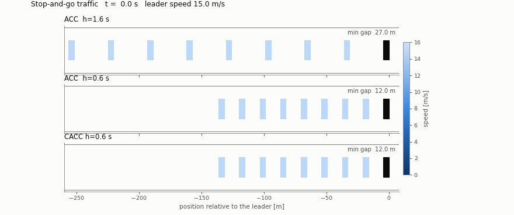
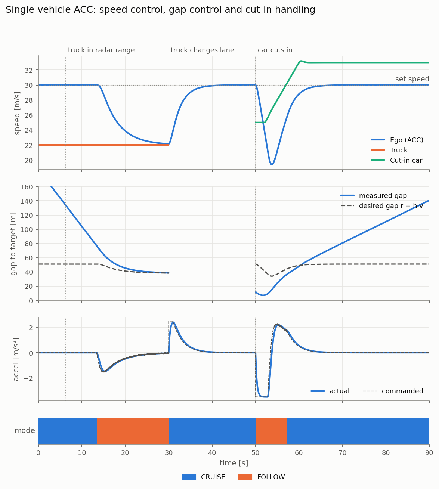
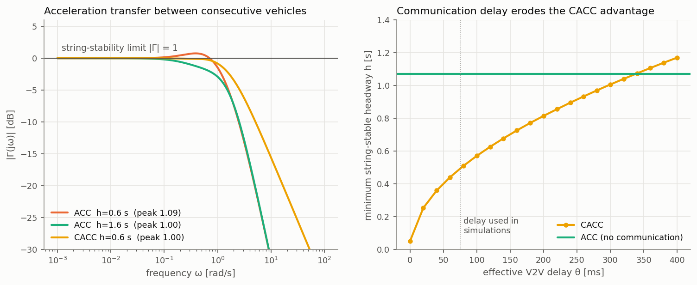
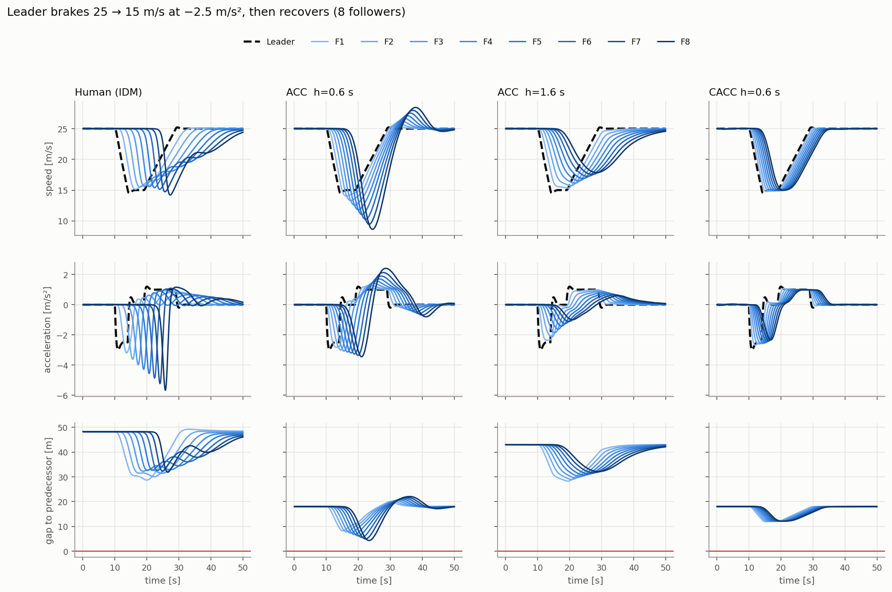
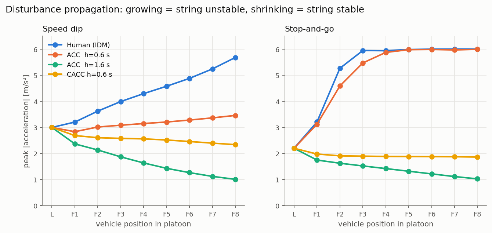
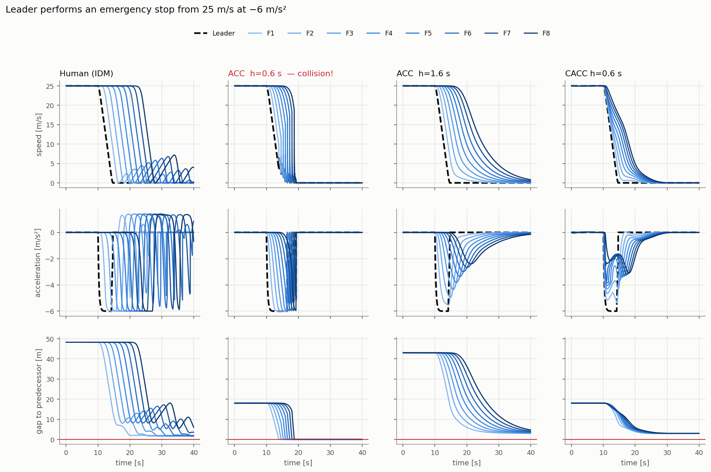
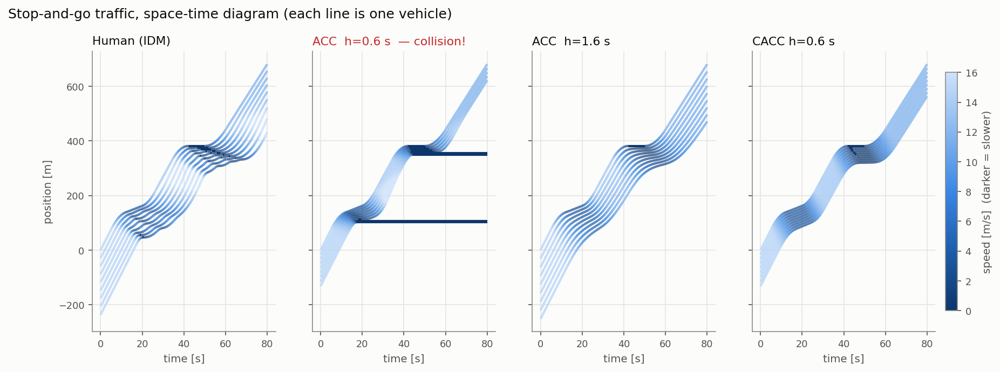
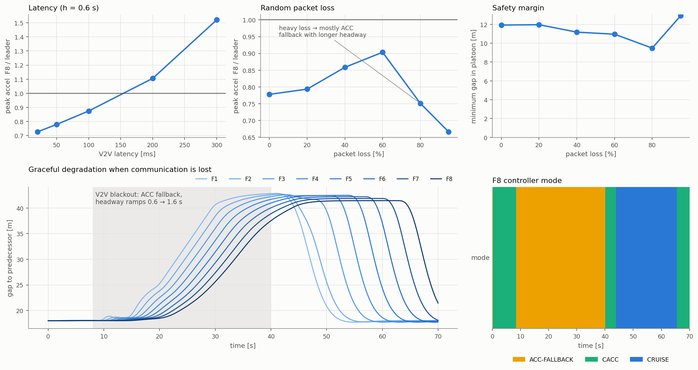

# Adaptive Cruise Control and Vehicle Platooning

A Python simulation platform (NumPy, SciPy, matplotlib) for designing and evaluating
**Adaptive Cruise Control (ACC)** and **Cooperative Adaptive Cruise Control (CACC)**
for vehicle platoons. It covers both time-domain simulation and frequency-domain
string-stability analysis.



---

## 1. Problem statement

Vehicles driving in a lane must keep a safe gap to the car ahead. Human drivers react
late and over-brake, which turns small speed changes at the front of a queue into
**stop-and-go waves** at the back ("phantom traffic jams"). Automated longitudinal
control can fix this:

| System | Sensors | Idea |
|---|---|---|
| **ACC** | front radar | Keep the set speed; when a slower car is ahead, keep a time gap of *h* seconds. |
| **CACC** | radar + V2V wireless | Also receive the predecessor's *intended* acceleration over V2V and use it as a feed-forward term, so the car reacts *before* the gap changes. |

The central question of this project is how short the gap can be while the platoon
stays safe and **string stable**, and what communication adds. String stable means
disturbances shrink rather than grow as they travel down the platoon. Short gaps
increase road capacity and reduce aerodynamic drag.

## 2. Models

### 2.1 Vehicle (`platoon_sim/vehicle.py`)
Each car is a third-order longitudinal model. The low-level engine and brake controller tracks a desired
acceleration *u* with a first-order lag τ (Rajamani 2012; Ploeg et al. 2011):

```
ẋ = v,   v̇ = a,   ȧ = (u − a)/τ          u ∈ [a_min, a_max] = [−6, 2.5] m/s²,  τ = 0.3 s
```
The lag is discretised exactly (zero-order hold, dt = 10 ms). Speed never goes negative, because the brakes hold at standstill.

### 2.2 Sensors and communication (`platoon_sim/sensors.py`)
* **Radar**: range 150 m, Gaussian noise (σ = 5 cm on range, 2 cm/s on range rate), and it detects only the nearest car in the same lane.
* **V2V link**: 20 Hz broadcast with 50 ms latency, Bernoulli packet loss *p*, and optional total blackout windows.

### 2.3 Spacing policy
Constant time headway: `d_ref = r + h·v`, with standstill gap `r = 3 m`. Spacing error `e = d − d_ref`.

### 2.4 Controllers (`platoon_sim/controllers.py`)
| Controller | Law |
|---|---|
| Cruise | `u_cc = k_v (v_set − v)` |
| **ACC** (Milanés and Shladover 2014) | `u_f = k_p e + k_d (v_{i−1} − v_i)`, then `u = min(u_cc, u_f)`, which switches between cruise and follow automatically. Optional ISO 15622 comfort braking limit (−3.5 m/s²) |
| **CACC** (Ploeg et al. 2011) | `h·u̇_i = −u_i + k_p e_i + k_d ė_i + u_{i−1}(t−θ)`, with `ė_i = v_{i−1} − v_i − h a_i` |
| CACC fallback | If no fresh V2V message arrives within 0.5 s, switch to ACC and **ramp** the headway 0.6 → 1.6 s (graceful degradation) |
| CACC safety supervisor | When V2V reports the predecessor braking harder than −4 m/s², brake at least hard enough to stop `r` metres behind it (kinematic check). This catches a car that is still closing a large gap at higher speed when the platoon emergency-brakes, a case the linear CACC law misses (found using the real-time simulator) |
| AEB | Full braking if time-to-collision < 1.5 s |
| Human baseline | Intelligent Driver Model (Treiber et al. 2000) with 0.6 s reaction delay |

Gains: ACC `k_p = 0.25, k_d = 0.8`; CACC `k_p = 0.2, k_d = 0.7`.

## 3. String stability theory (`platoon_sim/analysis.py`)

For identical vehicles, the transfer function from the predecessor's acceleration to the ego vehicle's acceleration is

```
ACC :  Γ(s) = (k_d s + k_p) / (τ s³ + s² + (k_d + k_p h) s + k_p)
CACC:  Γ(s) = (e^{−θs} + G K) / (H (1 + G K)),   G = 1/(s²(τs+1)),  K = k_p + k_d s,  H = 1 + h s
```
The platoon is string stable when `sup_ω |Γ(jω)| ≤ 1`. The code computes `|Γ|` with
`scipy.signal.freqresp`. It finds the **minimum string-stable headway** by applying
`scipy.optimize.brentq` to `sup|Γ| − 1`.

A unit test (`tests/test_platoon.py`) checks that the time-domain simulator reproduces
`scipy.signal.lsim(Γ, a_leader)` in the linear regime, so theory and simulation agree.

## 4. Results

Run `python experiments/run_all.py` to regenerate everything. Full numbers are in
[results/metrics.md](results/metrics.md) and [results/metrics.json](results/metrics.json).

### 4.1 Single-car ACC: cruise, follow, cut-out, cut-in


The car cruises at 30 m/s. It then slows down for a 22 m/s truck and holds the 1.6 s gap. When the truck
changes lane it resumes the set speed. When a car cuts in 12 m ahead, it brakes at the 3.5 m/s² comfort limit
(minimum gap 7 m, AEB never needed) and returns to cruise once the car pulls away.

### 4.2 Frequency-domain analysis


* ACC with no communication needs **h ≥ 1.07 s** to be string stable.
* CACC with a 75 ms effective delay (50 ms latency plus the 20 Hz sampling hold) needs only **h ≥ 0.49 s**.
* Every 100 ms of extra V2V delay costs about 0.25 s of headway. Above about 340 ms of delay, CACC loses its advantage over ACC.

### 4.3 Platoon of 8 followers: leader brakes 25 → 15 m/s



| Strategy (speed-dip scenario) | Peak accel F8 / leader | String stable | Min gap | Lane capacity @ 25 m/s |
|---|---|---|---|---|
| Human (IDM) | 1.90 | no | 28.7 m | ~1 700 veh/h |
| ACC h = 0.6 s | 1.15 | no | 4.3 m | ~4 000 veh/h |
| ACC h = 1.6 s | 0.34 | **yes** | 28.3 m | ~1 900 veh/h |
| **CACC h = 0.6 s** | 0.78 | **yes** | 11.9 m | **~4 000 veh/h** |

CACC gets the capacity of short-gap driving (about 2.1× that of ACC at h = 1.6 s) while staying string stable.
ACC can't do both: short gaps amplify disturbances, and stable gaps waste road space.

### 4.4 Emergency stop (−6 m/s²) and stop-and-go traffic



* Emergency stop: **ACC at h = 0.6 s ends in a pile-up of all 8 followers**. CACC at the same gap stops every car safely (minimum gap 2.95 m, hardest follower braking 5.4 m/s²), because the leader's braking command reaches all followers over V2V and the safety supervisor brakes early enough.
* Stop-and-go: human drivers and short-gap ACC amplify the waves up to the braking limit (6 m/s²), and short-gap ACC crashes. CACC and long-gap ACC damp them.

### 4.5 Robustness: V2V degradation and mixed vehicles


* **Latency**: CACC at h = 0.6 s stays string stable up to about 150 ms of latency. At 200 ms or more the disturbance grows (×1.1 at 200 ms, ×1.4 at 300 ms). The frequency-domain test (§4.2) is stricter: it flags h = 0.6 s as unstable from about 100 ms of latency. That is because it bounds the *worst* frequency, while the speed-dip manoeuvre excites only some frequencies.
* **Packet loss**: amplification rises up to about 60% loss. With heavier loss the controller spends most of its time in ACC fallback with a longer headway, which is safer but costs capacity. No collisions occurred at any loss rate.
* **Total blackout** (8–40 s): every car switches to ACC fallback, opens the gap smoothly, and returns to CACC and the short gap once the link recovers. No collisions.
* **Mixed vehicles** (τ from 0.2 to 0.6 s, including trucks): CACC still damps the disturbance end-to-end (×0.78), but one vehicle pair slightly amplifies it (×1.09). Strict string stability for mixed fleets needs per-vehicle tuning. This is a known open issue (see Further work).

## 5. Real-time interactive simulator

```bash
python realtime.py                 # interactive window
python realtime.py --demo          # auto-plays a 2-minute scripted scenario
python realtime.py --controller ACC --headway 0.6 --followers 6
```

The platoon drives at wall-clock speed (×0.5, ×1, ×2 or ×4) while **you drive the leader**.
The window has three parts:
* **Road view:** each car is coloured by its controller's current mode (CACC, ACC following, cruise, fallback, AEB). Dotted lines show active V2V links, and the camera follows the platoon.
* **Live plots:** speed, gap and acceleration of every vehicle over the last 30 s.
* **Status panel:** time, achieved real-time factor, minimum gap, mode counts, a live disturbance-amplification check (last car versus leader), and collisions.

| Control | Effect |
|---|---|
| Leader target speed slider, ↑ / ↓ keys | Accelerate or brake the leader |
| Emergency brake button, space key | Leader brakes at −6 m/s² to standstill |
| Time gap h slider | Change the followers' headway live (CACC ramps to it smoothly) |
| V2V packet loss and latency sliders, V2V radio checkbox | Degrade or cut communication and watch the fallback happen |
| Follower controller (CACC / ACC / Human) | Switch every follower's controller on the fly |
| Cut-in car button, c key | A **non-connected** car changes lane into the middle of the platoon, then leaves after 15 s |
| Pause (p), Sim speed, Reset (r) | Pause, change the speed factor, or start over |

Things to try: set h = 0.6 s, switch to **ACC**, and make the leader brake from 25 to 10 m/s. The
disturbance grows down the string, and with harsh enough braking the cars collide. Switch back to **CACC** and repeat:
it stays damped.

Rendering uses matplotlib with blitting. Only the moving artists are redrawn, and the road,
plots and status panel refresh at different rates. That gives about 25 fps on Tk while the physics
keeps exact real time. `python realtime.py --demo --snapshot shot.png --snapshot-time 50`
renders a frame without opening a window, which is useful for reports and for CI.

## 6. Project structure

```
platoon_sim/          core library
  vehicle.py          third-order longitudinal vehicle model
  sensors.py          radar + V2V channel (latency, loss, blackout)
  controllers.py      Cruise / ACC / CACC (+fallback, AEB) / IDM / scripted leader
  simulation.py       fixed-step simulation engine, collision handling, logging
  analysis.py         metrics, transfer functions, minimum-headway search (SciPy)
  scenarios.py        leader profiles, platoon builder, ACC test drive
experiments/
  run_all.py          all experiments -> results/*.png, metrics.json, metrics.md
  animate.py          GIF animation of platoons
  style.py            shared plot style / palette
realtime.py           real-time interactive simulator (GUI)
tests/test_platoon.py unit + validation tests (unittest)
results/              generated figures and metrics
```

## 7. How to run

```bash
pip install -r requirements.txt
python experiments/run_all.py          # all figures + metrics (~1 min; longer on a busy machine)
python experiments/animate.py          # results/platoon_animation.gif (a few minutes)
python realtime.py --demo              # real-time interactive simulator
python -m unittest discover -s tests -v
```

Minimal example:
```python
from platoon_sim.scenarios import run_platoon
from platoon_sim import analysis as an
res, _ = run_platoon(n_followers=8, kind="CACC", ctrl_kw={"h": 0.6},
                     profile="stop_and_go", T=80, v2v_loss=0.3)
print(an.string_amplification(res, "a")[0], res.collisions)
```

## 8. Suggested team workflow (Git)

1. One `main` branch, protected. Each member works on a feature branch (`feature/cacc-fallback`, `exp/packet-loss` …) and merges via pull request with one reviewer.
2. Run `python -m unittest discover -s tests` before every merge.
3. Possible split: **vehicle and sensor models** · **controllers** · **string-stability analysis** · **experiments, figures and report**.

## 9. Further work
* Mixed-fleet CACC: tune gains per vehicle from its own τ, or use a two-predecessor information topology.
* Model predictive control (MPC) for ACC with explicit comfort and safety constraints (e.g. `scipy.optimize`).
* Lane changes and platoon merging and splitting.
* Port the controllers to **Webots** / **CoppeliaSim** / **PyBullet** for 3-D vehicle dynamics. The controller interface `command(t, dt, ego, radar, msg)` is independent of the simulator.

## 10. References
1. R. Rajamani, *Vehicle Dynamics and Control*, 2nd ed., Springer, 2012 (Ch. 5–7: ACC and string stability).
2. D. Swaroop and J. K. Hedrick, "String stability of interconnected systems," *IEEE Trans. Automatic Control*, 41(3), 1996.
3. J. Ploeg, B. Scheepers, E. van Nunen, N. van de Wouw, H. Nijmeijer, "Design and experimental evaluation of cooperative adaptive cruise control," *IEEE ITSC*, 2011.
4. J. Ploeg, N. van de Wouw, H. Nijmeijer, "Lp string stability of cascaded systems: Application to vehicle platooning," *IEEE Trans. Control Systems Technology*, 22(2), 2014.
5. G. Naus, R. Vugts, J. Ploeg, R. van de Molengraft, M. Steinbuch, "String-stable CACC design and experimental validation: A frequency-domain approach," *IEEE Trans. Vehicular Technology*, 59(9), 2010.
6. V. Milanés and S. E. Shladover, "Modeling cooperative and autonomous adaptive cruise control dynamic responses using experimental data," *Transportation Research Part C*, 48, 2014.
7. M. Treiber, A. Hennecke, D. Helbing, "Congested traffic states in empirical observations and microscopic simulations," *Physical Review E*, 62, 2000.
8. R. E. Stern et al., "Dissipation of stop-and-go waves via control of autonomous vehicles: Field experiments," *Transportation Research Part C*, 89, 2018.
9. ISO 15622:2018, *Intelligent transport systems — Adaptive cruise control systems — Performance requirements and test procedures*.
